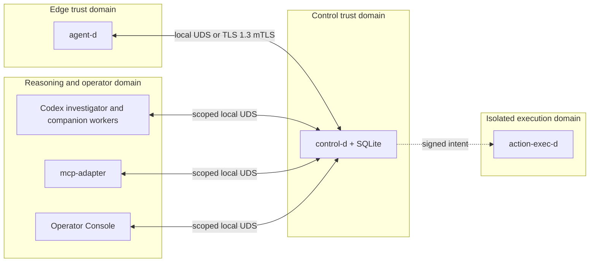

# Defensive Security Autonomous Mitigation Harness

A Linux defensive monitoring harness with a deterministic collection and policy core, episodic reasoning that proposes bounded follow-up watches, and opt-in, constrained containment with independent operator approval where required. Monitoring continues when the model is unavailable.



Run the custom model-adapter worker with `defsec-reasoner worker --socket /path/to/investigate.sock`. It defaults to the mock backend. Use `defsec-reasoner codex-worker --socket /path/to/investigate.sock` for the signed-in Codex CLI investigator. Codex sessions are ephemeral by default. Pass `--persist-sessions` or `--session-dir PATH` to enable session resumption. The controller retains the evidence and run history. Discovery, evidence reassessment and scheduled reviews can use independently configured model workers. [Setup and session lifecycle](docs/operator-agent.md#autonomous-worker)

The next product milestone is blind onboarding. An investigator should be able to learn an enrolled host’s role, document gaps in visibility and design appropriate monitoring before an incident opens. The [development charter](docs/design/DSAMH_Adaptive_Autonomous_Investigator_Development_Direction.md) sets the priorities. The [adaptive investigator design](docs/design/adaptive-investigator.md) maps them to current code and defines the first end-to-end test.

## Status

| Area | Status |
|---|---|
| Phases 1–5: protocol, control, edge, investigation and reasoning | Implemented |
| Phase 6: fleet mTLS, internal PKI CLI, and liveness watchdog | Implemented |
| Phase 8: bounded mitigation | Implemented, opt-in; executor defaults to dry-run |
| Operator Web Console | Implemented, demo and local live modes |
| Phase 7: external telemetry adapters | Planned |

Use it to track service, listening socket, file metadata and journal changes, preserve evidence, and investigate drift with controlled follow-up collection. Agents can connect locally over Unix sockets or across a LAN/VPN using outbound-only TLS 1.3 mTLS with host-bound SPIFFE URI SANs and live certificate revocation. It is not a replacement for an eBPF syscall EDR or a comprehensive SIEM.

The Python reasoner and Node console have no third-party runtime dependencies. Resource use depends on workload and system configuration; benchmark a deployment before setting service limits.

## Quick start

Requires Rust, Python 3.12 and Node 24. From the repository root:

```sh
cargo build --workspace
cargo test --workspace
PYTHONPATH=reasoner python3 -m unittest discover -s reasoner/tests -v
node --test console/test/server.test.mjs
node console/server.mjs --demo
# In another terminal, run the synthetic four-scenario benchmark:
PYTHONPATH=reasoner python3 -m defsec_reasoner benchmark --json-out bench.json --markdown-out bench.md
```

For a local single-host setup, build release binaries and run control and agent in separate terminals:

```sh
cargo build --release --workspace
./target/release/control-d --data-dir ./run-data
# another terminal
./target/release/admin-cli --admin-sock ./run-data/admin.sock enroll edge-01
./target/release/agent-d --host-id edge-01 --state-dir ./run-agent \
  --control-sock ./run-data/agent.sock --control-key-id control-key-01 \
  --control-pub-hex <CONTROL_PUBLIC_KEY_HEX>
```

Replace the placeholder with the public key returned by enrollment; omit the angle brackets. Socket permissions and peer UID policy must also permit the agent. See the [operator guide](docs/operations-and-deployment.md) for watches and lifecycle operations.

Read the [architecture](docs/architecture.md), [security model](docs/security-model.md), and [design document](docs/adaptive_defensive_monitoring_harness_design_v0.2.md). See [security reporting](SECURITY.md) and [contributing](CONTRIBUTING.md).

### Quiet-host discovery

When no incident trigger is queued, the reasoner advances discovery for enrolled
hosts within its Investigation capability. Supported agents collect one-shot
socket and package samples. The reasoner uses bounded excerpts to propose a
host purpose, dependencies, uncertainty, visibility gaps, and a monitoring
watch. Control validates the observation citations before saving a versioned
assessment. Host-scoped investigators and observers can read assessments and samples
through `get_host_assessment` and `get_host_discovery_samples` over Investigation
RPC or MCP. A proposed watch is assessment data and requires a separate policy
workflow to take effect.

Use `correlate_package_snapshots` over Investigation RPC or MCP to compare an
exact package name across two explicitly selected hosts. Supply two distinct
`host_ids`, a `package_name`, and a positive `max_age_seconds`. The caller needs
a host-scoped grant covering both hosts and `packages.inventory`. The tool checks
each host's latest recorded discovery observation and returns presence, citation
IDs and hashes, observation and receipt times, and any evidence gap.
`both_present` is null when either snapshot is incomparable. Shared presence
does not establish connectivity or causation.

Discovery evidence goes to in-process or loopback models by default. To allow
export, set `DEFSEC_DISCOVERY_EXPORT_GRANTS` on the reasoner to a JSON array of
grants. Each grant names one exact HTTPS provider base URL, one enrolled host,
and the collectors permitted for export. A single grant must cover every
sample in the interpretation, and the Investigation capability must separately
authorize access. Discovery requests disable HTTP redirects and environment proxies.

```json
[
  {
    "endpoint": "https://provider.example/v1",
    "host_id": "node-01",
    "collectors": ["sockets.listening", "packages.inventory"]
  }
]
```
