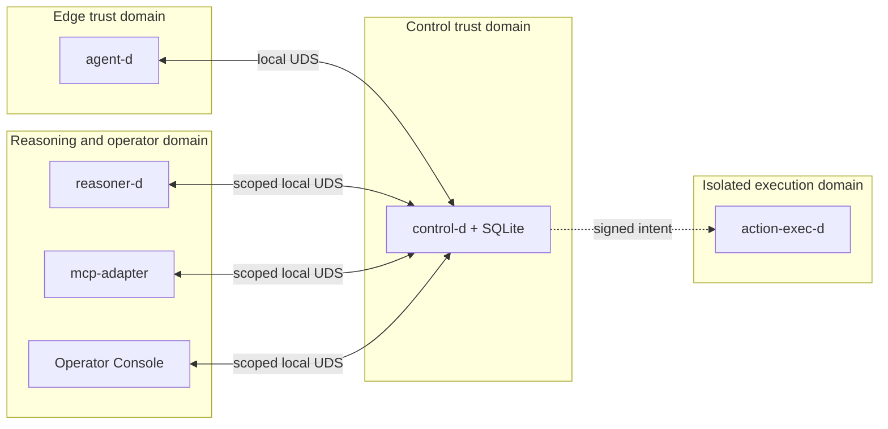

# Defensive Security Autonomous Mitigation Harness

A Linux defensive monitoring harness with a deterministic collection and policy core, episodic reasoning that proposes bounded follow-up watches, and opt-in, constrained containment with independent operator approval where required. Monitoring continues when the model is unavailable.



## Status

| Area | Status |
|---|---|
| Phases 1–5: protocol, control, edge, investigation and reasoning | Implemented for local use |
| Phase 8: bounded mitigation | Implemented, opt-in; executor defaults to dry-run |
| Operator Web Console | Implemented, demo and local live modes |
| Phase 6: fleet mTLS and PKI | Planned |
| Phase 7: external telemetry adapters | Planned |

Use it to track service, listening socket, file metadata and journal changes, preserve evidence, and investigate drift with controlled follow-up collection. It is not a replacement for an eBPF syscall EDR, a comprehensive SIEM, or a production multi-host WAN deployment. The current transport is local Unix sockets; fleet identity, rotation and mTLS remain future work.

The Python reasoner and Node console have no third-party runtime dependencies. Resource use depends on workload and system configuration; benchmark a deployment before setting service limits.

## Quick start

Requires Rust, Python 3.12 and Node 24. From the repository root:

```sh
cargo build --workspace
cargo test --workspace
PYTHONPATH=reasoner python3 -m unittest discover -s reasoner/tests -v
node --test console/test/server.test.mjs
node console/server.mjs --demo
# In another terminal, run the synthetic four-scenario benchmark:
PYTHONPATH=reasoner python3 -m defsec_reasoner benchmark --json-out bench.json --markdown-out bench.md
```

For a local single-host setup, build release binaries and run control and agent in separate terminals:

```sh
cargo build --release --workspace
./target/release/control-d --data-dir ./run-data
# another terminal
./target/release/admin-cli --admin-sock ./run-data/admin.sock enroll edge-01
./target/release/agent-d --host-id edge-01 --state-dir ./run-agent \
  --control-sock ./run-data/agent.sock --control-key-id control-key-01 \
  --control-pub-hex <CONTROL_PUBLIC_KEY_HEX>
```

Replace the placeholder with the public key returned by enrollment; omit the angle brackets. Socket permissions and peer UID policy must also permit the agent. See the [operator guide](docs/operations-and-deployment.md) for watches and lifecycle operations.

Read the [architecture](docs/architecture.md), [security model](docs/security-model.md), and [design document](docs/adaptive_defensive_monitoring_harness_design_v0.2.md). See [security reporting](SECURITY.md) and [contributing](CONTRIBUTING.md).
