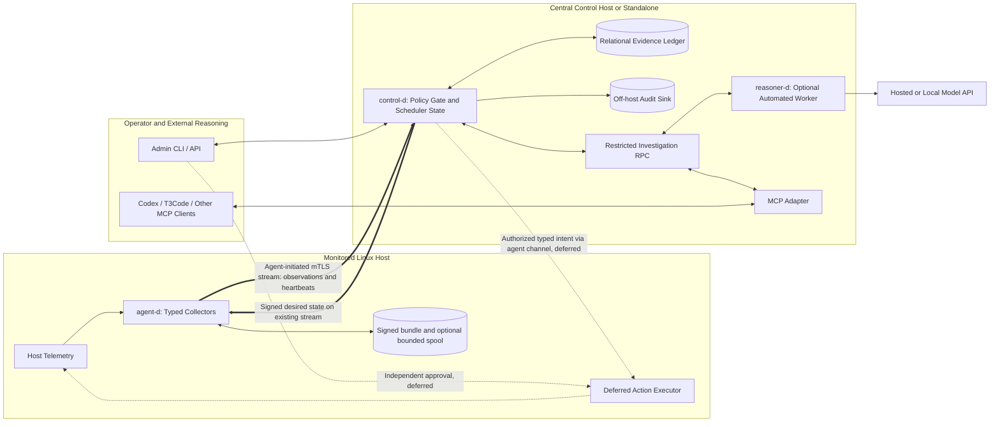

# Adaptive Defensive Monitoring Harness — System Design Document

**Status:** Revised Draft for Review (v0.2)  
**Scope:** Read-only defensive monitoring MVP with interactive and automated reasoning (Phases 1–5), fleet hardening (Phase 6), and deferred specialized integrations and gated remediation (Phases 7–8)  
**Target Environments:** Resource-constrained edge VMs (e.g., dense VMware/ESXi deployments), standard Linux servers, and standalone single-host installs  

---

## 1. Executive Summary & Core Thesis

This document specifies a persistent, event-driven defensive monitoring harness for Linux hosts. Rather than running an LLM as an always-on monitoring daemon, the system separates **deterministic telemetry collection and enforcement** from **episodic, evidence-backed reasoning**:

* **The deterministic plane** collects normalized host state, suppresses unchanged ticks, tracks baselines, enforces security and resource policies, and wakes the reasoning layer only on meaningful anomalies.
* **The reasoning plane** acts as a constrained *policy compiler* and investigator—correlating evidence, proposing short-lived, bounded watch specifications to gather follow-up signal, and producing attributable findings.

The system is designed around a **thin edge agent + central control plane** topology that can also be packaged for standalone single-host deployments without duplicating business logic. The platform must remain fully operational, predictable, and useful when no LLM is connected. The reasoning plane is a replaceable interface rather than a mandatory agent framework: direct model APIs, local inference, and operator-driven agent frontends can all use the same bounded investigation contract. Interactive investigation should precede automated reasoning so that the usefulness of the observation surface can be tested before committing to a particular model client.

**Core research hypothesis:** A model that can select bounded follow-up observations after an initial anomaly can improve investigative coverage, latency, or signal quality relative to a fixed monitoring strategy under comparable resource budgets. The platform is not predicated on that hypothesis being true; the deterministic core must independently deliver useful monitoring.

---

## 2. Core Principles & Explicit Non-Goals

### Architectural Principles
1. **Model as policy compiler, harness as execution engine:** The model proposes structured watch specifications and investigation hypotheses; deterministic application code validates, schedules, and executes them.
2. **Desired-state sync, never a command relay:** Synchronize signed, versioned declarative watch bundles, never arbitrary shell commands or ad-hoc execution instructions.
3. **State belongs in durable storage, not the context window:** Watch specs, baselines, observations, incidents, leases, and wake budgets survive restarts and reasoning-backend swaps.
4. **Metadata-first observation:** Emit normalized structural metadata (hashes, permissions, socket tuples, unit states). Any bounded journal text is explicitly classified and redacted; raw file contents and unbounded stdout are excluded.
5. **Physical trust-domain separation:** Enforce privileges at OS process, user, network, and cryptographic layers—not through prompt instructions.
6. **Edge minimalism:** Minimal CPU/RAM overhead, no local database engine, no LLM credentials, and no inbound listening ports. Optional bounded disk spooling improves outage durability without an embedded database.
7. **Replaceable reasoning backends:** Neither a hosted provider nor a third-party agent runtime owns the monitoring schedule, incident ledger, or enforcement decisions.
8. **Extensibility through capabilities:** Expand observation types through administrator-reviewed collectors and typed schemas, not executable code supplied by a model.
9. **Evidence before conclusions:** Record immutable evidence references, policy decisions, run identity, and baseline revisions; distinguish observations from hypotheses and verified findings.

### Explicit MVP Non-Goals (Deferred or Rejected)
* **No mandatory general-purpose agent framework (e.g., Norma):** A thin provider adapter is sufficient for automated episodic reasoning. External harnesses may be optional clients through a restricted interface, not part of the trusted core.
* **No multi-agent swarms:** Single-investigation runs keep audit trails clear and limit injection surfaces. Concurrent independent incidents may be processed within explicit quotas.
* **No graph database:** Relational tables express host and incident relationships through MVP and early fleet scale.
* **No arbitrary script/command collectors:** Only built-in typed collectors initially; later extensions must be approved independently of the model.
* **No autonomous remediation in the MVP:** Response capabilities are disabled at build/config time; deferred remediation requires independent authorization.
* **No claim of tamper-proof endpoint monitoring:** A sufficiently privileged host attacker can suppress or falsify local observations. Off-host liveness, evidence retention, and independent telemetry reduce—not eliminate—this limitation.

---

## 3. System Topology & Trust Domains

The architecture divides collection, control, reasoning and operator access into explicit trust domains, with a separately privileged executor reserved for deferred remediation.



### Trust-Domain Matrix

| Component | Language (Recommended) | OS Privilege & Network | Owned State | Security Invariant |
|---|---|---|---|---|
| **`agent-d`** (Edge Agent) | Rust (musl where practical) | Dedicated unprivileged identity; narrowly scoped telemetry access; agent-initiated mTLS only, zero inbound listening ports | Cached signed bundle, version high-water mark, stream cursors, bounded RAM state and optional spool | Local safety floor; no LLM keys or prompts; rejects invalid or stale bundles |
| **`control-d`** (Control Server) | Rust preferred | Dedicated user; agent mTLS endpoint, admin socket, restricted investigation RPC; no direct inference-provider access | Authoritative ledger, baselines, policies, queue, budgets, bundle signer | Sole authority for policy, ledger commits, quotas and desired-state sync |
| **`reasoner-d`** (Optional Automated Worker) | Python or TypeScript candidate | Unprivileged process; only investigation RPC and approved inference egress | Transient context; durable run and incident state lives in control plane | Can submit scoped proposals but cannot directly mutate hosts, baselines or the database |
| **MCP Adapter / External Frontend** | Thin adapter over shared RPC | Separate service identity; authenticated client sessions; no host credentials, shell or DB access | Transient session mapping; authoritative actions recorded centrally | MCP exposes the same policy gate, not a second authority path |
| **Remediation Executor** *(Phase 8)* | Rust, separate binary preferred | Isolated privileged scope; no inference connectivity | Verification, replay protection and rollback receipts | Only precompiled verbs authorized by independent signatures |

The control server's signing authority is separate from the human approval authority. The edge safety policy cannot be loosened by a watch bundle. Standalone mode preserves process/user isolation except in the explicitly non-production in-process test configuration.

---

## 4. Deployment Modes & Wire Contract

A narrow `Transport` abstraction permits the same domain logic across a fleet or an isolated single host:

* **Fleet Mode:** `agent-d` initiates a persistent bidirectional gRPC/mTLS stream to `control-d`; desired-state updates flow down the existing connection, without an edge listener. Missed heartbeats generate explicit liveness incidents after a configurable grace period.
* **Standalone Mode (Process-Isolated):** Services communicate through local Unix sockets authenticated via filesystem permissions and `SO_PEERCRED`. Separate service identities and restricted RPC remain mandatory.
* **Standalone Mode (Single-Binary Dev/Lab):** Optional in-process bounded channels with local SQLite. This is a test configuration, not equivalent to production privilege isolation.

### Core Wire Message Flows

| Message | Direction | Payload / semantics |
|---|---|---|
| `Register / Heartbeat` | Agent → Control | Authenticated host identity, agent version, boot/session ID, active bundle version, resource health, last sequence, dropped-event counter, collector freshness and bounded run summaries |
| `PushObservationDelta` | Agent → Control | Host/session/watch/spec version, sequence, event and receive times, state hash, full snapshot or delta with base hash, status; changes, errors and reconciliation checkpoints only |
| `ObservationAck` | Control → Agent | Highest contiguous durably committed sequence for the session; retransmit unacknowledged observations; deduplicate by identity and sequence |
| `RequestReconciliation` | Control → Agent | Full snapshot for active watches after gaps, reconnects, invalid delta base or version mismatch |
| `SyncWatchBundle` / `BundleAck` | Control ↔ Agent | Signed desired state; atomic validation and activation; report accepted version, digest, rejected reason or expiry |
| `ActionIntent` / `ActionResult` *(Phase 8)* | Bidirectional | Typed verb, scoped parameters, intent ID, independent approval and control signatures, validity window and verification receipt; disabled in MVP |

Delivery is **at least once**, not exactly once. The controller commits an observation and its derived events atomically before acknowledging it. A full snapshot establishes present state, not proof that historical gaps have been recovered. Unknown schema versions or missing delta bases fail explicitly; never silently interpret them as healthy.

### 4.1 Signed Desired-State Envelope

```yaml
schema_version: 1
bundle_id: bundle-42
target_host_id: edge-vm-07
bundle_version: 42
issued_at: "2026-11-24T18:00:00Z"
expires_at: "2026-11-25T18:00:00Z"
signing_key_id: control-key-01
policy_version: 3
watches: []   # typed watch specs
signature: "<signature over canonical payload, excluding signature field>"
```

* Use Ed25519 signatures over a specified canonical representation, independent of wire encoding; do not assume arbitrary Protobuf or JSON encoders produce identical signing bytes.
* Bind bundles to enrolled host identity, schema and policy version. Persist the highest accepted bundle version atomically with the accepted bundle digest; reject replayed versions, except identical retransmissions. Authorized rollback is issued as a new, higher version.
* Define certificate enrollment, renewal, revocation and signing-key rotation. Pre-provisioned trust roots are acceptable for a lab; production rotation must not depend on the compromised key alone.
* Validate expiry with bounded clock-skew handling and locally enforce ephemeral TTL/max-runs. On reboot, uncertainty about expiry must not extend an ephemeral watch indefinitely. Preserve last accepted baseline monitoring under local policy when disconnected, flag stale desired state, and expire ephemeral watches conservatively. Do not stop baseline monitoring solely because a control-plane lease expired.
* A signature authenticates the issuer, not the safety of the contents: local allowlists and resource ceilings still apply. The edge's local policy is managed through a separate trusted administrative path.

### 4.2 Protocol Choices

Prefer gRPC over mTLS for fleet transport and explicit Protobuf schema versions, with Unix sockets for local RPC. Share Rust domain types and validation logic where appropriate, but keep edge-specific and central-only policies distinct. Select the actual encoding and TLS implementation after measuring the edge memory budget.

---

## 5. Edge Agent Design (`agent-d`)

`agent-d` is intended to run unobtrusively on dense VMware VMs and constrained edge nodes (512 MB–1 GB RAM guests).

### 5.1 Collector Primitives

1. **`SnapshotCollector` (Periodic State Reconciliation):** Poll normalized state (stable sorting, explicit volatile fields), compute deterministic SHA-256 hashes, and emit changes, status transitions and periodic full checkpoints (e.g., every 15 minutes). Preserve meaningful identity fields such as PID start time where necessary; do not strip security-relevant changes merely to reduce noise.
2. **`StreamCollector` (Event-Driven with Cursor):** Subscribe to native event sources such as journald; emit bounded event batches even if the same text recurs. Persist cursors according to the delivery guarantee and reconcile snapshots on startup or overflow. A snapshot cannot restore missed historical stream events.

Unchanged snapshots do not need full payload transmission, but bounded heartbeat summaries report completed runs, success/failure, freshness and sustained-condition counters. Otherwise a central `threshold_sustained` predicate cannot distinguish N successful identical ticks from N missed ticks. For sustained predicates, use a deterministic per-watch counter evaluated from actual completed samples at the edge and report the necessary count, condition transition and sample freshness; the controller verifies policy and decides whether to wake reasoning. Reset counters on spec changes, gaps or invalid samples unless the protocol proves continuity. Neither plane infers elapsed samples from a timer alone.

### 5.2 Edge-Lite Diffing & Bounded Disconnect Buffer

Maintain `watch_id -> (last_hash, last_normalized_state)` with strict per-collector and aggregate byte ceilings. Large socket/file inventories must be paginated or rejected explicitly, not silently truncated into an apparently complete baseline.

| Durability profile | Storage | Trade-off |
|---|---|---|
| Minimal | Fixed RAM ring (e.g., 1–2 MiB) plus small atomic metadata files | Lowest overhead; unacknowledged events can be lost on restart |
| Durable | Bounded append-only disk segments (initial candidate 8–32 MiB) | Survives agent restart; finite outage capacity |
| Forensic | Administrator-sized bounded spool with explicit retention | Greater historical retention, disk and privacy cost |

* No embedded database engine is required. Protect cached bundles, high-water marks, cursor files and spool with restrictive permissions and atomic writes. Persist sequence/session metadata consistently with spool records; checkpoint cursors only after the selected durability guarantee is satisfied.
* On buffer saturation, preserve high-priority status/gap records where possible, count dropped observations, and apply explicit bounded eviction. The next connection reports gaps and triggers full reconciliation; never claim that current-state recovery restores lost history.
* Use stable event identity `(host_id, session_id, seq_no)`; differentiate restart from replay and duplication. Retransmit pending records until durable acknowledgment, within retention limits.
* Spool encryption and disk quotas are policy choices. Local privileged compromise can still destroy or forge local state; remote retention is the stronger evidence boundary.

### 5.3 Local Safety Floor (Defense in Depth)

Even if `control-d` is compromised, `agent-d` independently enforces local hard ceilings:

* Verify host-bound signature, version, validity, schema and policy. Reject unknown collector types/fields (`#[serde(deny_unknown_fields)]` where appropriate), unrecognized capabilities, excessive intervals/paths/scan sizes and concurrent work beyond configured caps.
* Minimum interval (e.g., 15s), timeouts, output limits, max concurrent collectors and aggregate CPU/I/O budgets. Enforce ephemeral expiry and max-runs locally across restarts.
* Restrict filesystem metadata and hashing to approved roots; deny sensitive paths such as `/etc/shadow`, home directories and SSH private keys. Resolve paths safely relative to approved directory handles; guard against symlink traversal, mount changes, special files and time-of-check/time-of-use races. Hash only bounded regular files.
* Validate every parameter according to its collector schema, not just the collector name. No arbitrary executable or shell string is part of the watch grammar.
* Report unsupported/permission-denied observations and partial visibility explicitly. Do not escalate to root merely to make a collector work.

### 5.4 VMware & Edge Resource Guardrails

* **Anti-thundering-herd scheduling:** Stable hash of host/watch IDs spreads poll phases. Apply bounded reconnect jitter and a global concurrency/rate limit for expensive collectors; jitter alone is not an I/O guarantee.
* **Initial performance targets, not validated requirements:** idle RSS 4–8 MiB (initial acceptance goal <10 MiB), peak memory measured under realistic TLS, D-Bus, journal and spool workloads. A 24 MiB hard cap is an experimental constrained profile, not a universal default; select `MemoryHigh`/`MemoryMax` using peak measurements and headroom. A 5% `CPUQuota` limits the service to 5% of one CPU, so benchmark collection latency and missed work before adopting it. Candidate defaults: `TasksMax=16`, `Nice=10`, idle I/O class where supported. Report throttling or OOM-induced gaps.
* **Process sandboxing:** Drop unnecessary capabilities, apply `NoNewPrivileges`, systemd hardening and Landlock where supported. Probe kernel/ABI support; explicitly document fallback policy and test actual effective access. Do not silently weaken required production boundaries.
* **Collector permissions:** `/proc` socket-to-process attribution, journal access and file hashing have different OS permission requirements. Test `hidepid`, namespaces, SELinux/AppArmor, journal group access and distro/kernel variations. Use partial observations or a separately reviewed narrow reader when necessary, not a broadly privileged edge agent.

### 5.5 Collector Registry & Extension Boundary

Each collector has a stable capability ID, schema version, typed inputs/outputs, sensitivity classification, resource limits and declared privilege requirements. The reasoning interface can discover only authorized capabilities for the assigned host. New collector implementations are administrator-reviewed, versioned and shipped through a trusted release/configuration path; model proposals may configure them, never install code. Future adapters can ingest existing osquery, Wazuh, Falco, Tetragon, Prometheus, Kubernetes or SNMP telemetry without requiring the model to execute commands or the project to replace those platforms.

---

## 6. Control Plane & Durable State (`control-d`)

### 6.1 Three-State Baseline Semantics

Maintain three explicit concepts per `(host_id, watch_id, spec_version)`:

1. **`last_observed`:** Prior successful normalized observation, used to distinguish new changes from continuing drift.
2. **`accepted_baseline`:** Versioned known-good state; never automatically advanced by a single anomaly or solely because a change occurred in a maintenance window.
3. **`current_observed`:** Incoming observation evaluated against both the previous observation and accepted baseline before advancing the last-observed pointer.

Observation errors, gaps and stale collectors are first-class states, not healthy values. Preserve the last successful snapshot separately from the latest collector status. An ephemeral watch can use an explicitly labeled initial reference or `last_observed`; it cannot manufacture a trusted baseline. If an accepted baseline is absent, predicates requiring one return an explicit unavailable state.

Baseline promotion records approver identity, previous/new revision, supporting observation IDs, timestamp, rationale and maintenance-ticket reference where applicable. Maintenance windows may suppress notification noise, but state changes remain recorded and acceptance requires verified expected state or explicit operator approval. Baselines are immutable revisions with a current pointer; a rollback is a new attributable revision.

### 6.2 Non-Turing-Complete Watch Specification DSL

Predicates are a closed, strongly typed tagged union over collector-defined fields. Arbitrary shell commands, script engines, raw file-content regexes and deterministic cross-watcher joins are excluded initially.

* `field_changed` — named typed fields vs. prior observation or accepted baseline.
* `set_diff` — added/removed normalized set elements, with stable identity keys.
* `threshold_sustained` — typed numeric condition for N actual valid consecutive samples.
* `collector_stale_or_error` — missing samples, timeout or repeated errors; host liveness is also monitored independently of any watch.

#### Conceptual Watch Spec Example

```yaml
id: ephem-inc42-unit-watch
version: 1
host_id: edge-vm-07
class: ephemeral
incident_id: inc-2026-0042
collector:
  type: systemd.unit_state
  parameters:
    unit: custom-helper.service
schedule:
  interval_seconds: 30
  timeout_seconds: 5
trigger:
  type: field_changed
  compare_against: last_observed
  fields: [active_state, sub_state, exec_start_hash]
wake_policy:
  cooldown_seconds: 180
  max_wakeups_per_hour: 4
lifecycle:
  enabled: true
  expires_at: "2026-11-24T22:50:00Z"
  max_runs: 480
```

The example uses the prior observation rather than assuming an accepted baseline exists for an ephemeral watch. TTL and max-runs are independent upper bounds; whichever occurs first retires the watch. Predicate-specific debounce semantics must be defined explicitly rather than treating repeated identical samples as repeated changes.

### 6.3 Policy Validator Gate & Quotas

Every proposal passes the same deterministic validation path, regardless of whether it came from `reasoner-d`, Codex, another MCP client, or an operator acting as a reasoning client.

* **Baseline protection:** Reasoning identities cannot create, edit, pause, delete or promote baseline watches. Baseline administration requires a distinct authenticated role.
* **Strict envelope:** Ephemeral watches use authorized collector IDs, approved path/unit patterns, bounded intervals and mandatory TTL (e.g., ≤4h), max-runs and output sizes.
* **Quotas:** Initial caps of five ephemeral watches per incident and ten per host, plus cumulative proposal and resource budgets. Prevent equivalent-watch duplication and indefinite renewal through watch replacement. Enforce at control and edge boundaries.
* **Wake circuit breaker:** Durable per-watch, per-host, per-incident and global quotas, with provider spend and concurrency limits. Under floods, deterministic collection, evidence recording and operator alerts continue. Reserve capacity for high-priority health events and report suppression.
* **Incident authorization:** Scope each run to assigned hosts, incident, permitted collectors, data classification and expiry. Validate scope server-side on every call; never trust model-provided IDs as authority.

### 6.4 MVP Relational Ledger

SQLite WAL with a single authoritative writer is the first implementation. Use `synchronous=FULL` for the writer where durability is required; select retention, backup and checkpoint policies deliberately. PostgreSQL migration is deferred until measured fleet load warrants it. JSON columns are acceptable for evolving payloads, but stable identity and relationships remain relational.

| Record / logical table | Purpose & key fields |
|---|---|
| `hosts` | Enrollment identity, version, session, heartbeat, resource and liveness status |
| `watch_specs` | Immutable watch revisions, host/incident, class, typed spec, creator, expiry, active revision pointer |
| `watch_state` | Last success/status, hashes, baseline revision pointer, counters, cooldown, freshness, last run |
| `baseline_revisions` | Immutable reference state, predecessor, evidence, approver, policy/ticket/rationale |
| `observations` | Append-only evidence IDs, host/session/sequence, watch/spec revision, timestamps, canonical payload/hash, status and completeness |
| `trigger_events` | Durable pending/leased/done/dead-letter queue, dedup key, lease owner/token/expiry, retry count, evidence refs |
| `incidents` | Host scope, lifecycle, priority, summary and closure metadata |
| `agent_runs` | Mandatory run ID, backend/model/version, prompt/tool schema versions, trigger refs, budgets, usage where available, start/end/outcome |
| `watch_proposals` | Submitted spec, run/principal, incident, idempotency key and resulting watch revision if accepted |
| `policy_decisions` | Immutable accept/deny rationale, rule/policy version, request ID and actor |
| `findings` / `finding_evidence` | Hypothesis vs. verified conclusion, severity, uncertainty, stable observation IDs and evidence hashes |
| `wake_budget_state` | Persisted token buckets, spend reservations, usage/reconciliation and circuit-breaker state |

These are logical records; physical table layout can be simplified without dropping their audit semantics. Foreign keys, unique event/idempotency constraints and explicit transactions are mandatory. Store only bounded redacted run summaries by default, not complete provider transcripts; optional sensitive artifacts require separate retention/access controls.

### 6.5 Queue, Evidence & Off-Host Tamper-Evidence

* Coalesce related pending triggers by host/incident and fingerprint within a bounded window, preserving all contributing evidence IDs. Lease with owner, expiry and fencing token; retries are idempotent and stale workers cannot commit results under expired leases. Never mark a run complete until its findings/proposals and terminal status are committed.
* Separate immutable observations, model hypotheses and independently verified findings. Evidence references use IDs and canonical hashes, not matching text or time proximity; evidence binding proves which data was cited, not that the conclusion is true.
* Record an append-only hash-chained audit stream of policy decisions, watch changes, run outcomes and baseline promotions to an independently controlled off-host destination. Persist an outbox alongside ledger transactions; retry delivery with bounded backlog and explicit sink failure alerts. Use periodic externally retained sequence/hash checkpoints to make truncation detectable; hash chains alone cannot prove that a compromised source recorded every event.
* Define observation and audit retention separately. Preserve incident-linked evidence according to policy; avoid dangling references through tombstones or retained immutable evidence manifests. Monitor disk usage and audit backlog. Off-host auditing is required for production claims of compromise resilience, optional in isolated development mode.

### 6.6 Investigation Lifecycle

Anomaly → durable trigger → incident correlation → operator or automated run → evidence query → optional scoped watch proposal → policy validation → signed bundle → observations → follow-up trigger or closure. Incident closure retires ephemeral watches unless a separately authorized extension exists. Runs end on explicit completion, tool/token/time budget, lease expiry or operator cancellation. An investigation does not remain active merely because an LLM session exists.

---

## 7. Reasoning Plane & External Frontends

The reasoning plane is a contract, not a required implementation. The deterministic core does not depend on a running model client. `reasoner-d` is one optional implementation; operator-driven investigations can begin before it exists.

### 7.1 Backend and Frontend Roles

| Integration | Intended role | Boundary |
|---|---|---|
| Direct hosted model API | Automated episodic investigation | Provider-specific adapter; bounded tool loop, explicit budgets |
| Local model API (Ollama/vLLM or other supported endpoint) | Privacy-sensitive or low-cost reasoning | Same tool contract; evaluate tool-call reliability |
| Codex CLI/SDK | Optional noninteractive or supervised investigation runner | Isolated process/workspace; no production host credentials or direct database access |
| Codex app-server / T3Code / Gemini or other compatible clients | Operator-driven investigation UI | Authenticated MCP client; identical central policy gate |
| Codex Security or other source-audit tools | Deferred source-level investigation of related application repositories | Separate restricted analysis environment, explicit repository scope and structured result import |

The direct tool-calling adapter is the preferred first automated backend (Python or TypeScript candidate). Do not assume every provider speaks the same JSON tool dialect; normalize tool calls, errors, finish states and usage in adapters. Codex integrations are candidate paths, not verified dependencies. Check current SDK, CLI/app-server interfaces, authentication, account entitlements, automation limits and data-handling terms before implementation; a ChatGPT subscription or security-access program is not a platform requirement.

Codex Security is a specialized application-security capability rather than a Linux monitoring frontend. A future integration can link an observed application change to a separately authorized source review and import evidence-linked findings. It must not automatically patch deployed hosts or inherit monitored-host credentials. Evaluate whether existing integration interfaces actually expose the necessary functionality before adopting them.

### 7.2 Shared Bounded Investigation RPC

`control-d` exposes typed domain operations used by the direct backend and an MCP adapter. Every call has an authenticated principal, incident/run scope, expiry, request ID and server-side quota. Read-only inventory/discovery operations return only permitted hosts and capabilities.

| Operation | Semantics |
|---|---|
| `list_hosts`, `list_active_incidents` | Bounded authorized discovery; filter and paginate |
| `list_active_watches`, `list_collector_capabilities` | Read effective watches and available typed capabilities within scope |
| `get_incident_context(incident_id)` | Compact timeline, active hypotheses and watches |
| `query_observations(host_id, watch_id, since, limit)` | Bounded, classified/redacted evidence slices with stable IDs |
| `get_host_baseline_summary(host_id)` | Accepted reference state and revision IDs |
| `propose_ephemeral_watch(spec)` | Submit typed proposal; return policy decision and watch ID if accepted |
| `record_hypothesis_or_finding(...)` | Record scoped conclusion, evidence IDs, uncertainty and escalation request |

For MVP, findings are model assertions pending independent validation where required. Baseline promotion, policy modification, signing keys, collector installation and remediation are absent from the reasoning tool surface. Operator administrative tools run on a separate interface/role.

### 7.3 MCP Adapter & Existing Agent Frontends

Expose a narrow MCP server over local stdio or authenticated remote transport as appropriate. It translates schema-validated tool calls into the shared RPC; it is not a second scheduler or policy engine. Separate read-only and proposal-capable roles; explicitly authorize the latter. Bind external sessions to short-lived scoped capabilities, validate credentials and audience, and prevent cross-incident or cross-host access. For remote HTTP, define authentication, transport security, origin/host validation and rate limiting.

Example operator flow: inspect an unexpected service change, review approved maintenance context and observations, submit a temporary typed watch proposal, and revisit the incident after new evidence arrives. No SSH, host shell, direct SQL or arbitrary collector code is required.

External harnesses may have their own filesystem and shell tools. The monitoring platform's RPC boundaries do not sandbox those tools; launch automated harness clients with an independent restricted OS identity, clean workspace, minimal environment, approved egress and no production SSH or cloud credentials. Interactive operator tools remain subject to the operator's separate privileges; do not claim that the MCP server constrains unrelated tools.

### 7.4 Automated Episodic Worker (`reasoner-d`)

A worker leases a trigger envelope, obtains short-lived run-scoped authority, assembles bounded context, calls a chosen model, and returns to dormancy. No opaque persistent agent memory is authoritative. Example limits: six tool turns, bounded wall time, context/output bytes, token and spend reservations, provider concurrency, and proposal cap per run. Persist run metadata and outcomes through the controller. Provider failure, exhausted quotas or expired leases must not interrupt deterministic monitoring. Requeue transient failures with bounded backoff or dead-letter and alert on repeated failure.

### 7.5 Prompt-Injection, Privacy & Provenance

* Treat all monitored fields, journal messages, imported artifacts and model-produced summaries as potentially adversarial. Use explicit source/provenance envelopes, bounded field lengths and structural separation; prompts are advisory, never enforcement.
* Metadata can still be sensitive: command arguments, paths, unit descriptions, journal text, network endpoints and even hashes may disclose information. Define collector-specific allowlists, deterministic redaction, data classification, provider routing, retention and tenant/host access rules before exporting telemetry. Journal text is opt-in or strictly bounded/redacted under the applicable policy. Redaction is not a guarantee of perfect secrecy; deny external inference for restricted data classes.
* Even a hijacked model cannot bypass the central validator, enlarge its incident scope, disable baseline monitoring, access raw file contents through the RPC, or execute remediation in the MVP. It may still produce misleading conclusions or abuse legitimate scoped calls; enforce budgets and require independent verification for consequential decisions.
* Record evidence IDs, model/backend identity, prompt/schema version and policy decisions. Validate evidence ownership and existence; do not treat citations as proof of correctness. Provide a human-readable distinction between observed fact, hypothesis, inference and verified outcome.

---

## 8. Phase 8: Response & Remediation Architecture (Deferred)

Remediation remains explicitly outside the read-only MVP. The boundary is reserved now to avoid redesigning trust domains later.

* **Compile-time and config-time opt-in:** Edge agents ship without enabled remediation. Prefer a separate privileged executor with a small reviewed verb catalog.
* **Independent dual authorization:** A future model may submit an `ActionProposal` with evidence IDs, expected effect, blast radius and rollback plan. Execution requires both a control authorization signature and an independent operator approval signature over the same canonical host-bound intent, parameters, policy version, nonce and validity window. Neither reasoning client nor control server alone can execute it. Hardware-backed approval is a candidate; key custody and signing UX require verification.
* **Narrow idempotent catalog:** No shell execution. Candidate typed verbs include time-limited network blocks, stopping explicitly approved services, and controlled host isolation preserving recovery access. These are design placeholders, not approved operational defaults; service availability, scope, rollback and independent recovery requirements must be tested separately.
* **Intent-before-effect:** Commit attributable action intent and approval prior to dispatch. Edge verifies both signatures, replay protection, local policy, prerequisites and expiry. Persist receipts and prevent duplicate effects across retries.
* **Independent verification and recovery:** Re-run relevant collectors after execution, record actual state separately from executor success, enforce rollback/expiry where supported and notify on failure. Preserve management/recovery access. A successful command response is not proof of successful mitigation.
* **Feedback-loop prevention:** Rate limits, causal action IDs, cooldowns and idempotency prevent remediation-triggered changes from initiating unbounded mitigation cycles. Preapproved deterministic actions, if ever added, require distinct human-owned policies and separate evaluation; model-generated watches do not authorize actions.

---

## 9. Phased Roadmap & Validation Plan

### Implementation Phases

| Phase | Scope | Exit Criteria |
|---|---|---|
| **1. Deterministic Core** | Rust edge and control services, four collectors, SQLite ledger, scheduler, versioned baselines, CLI, audit outbox | Useful without LLM; measured edge footprint; correct snapshots, status and restart/gap behavior |
| **2. Secure Control Interface** | Typed RPC, local safety floor, scoped identities, signed bundle protocol, quotas, durability profiles | Replayed/wrong-host bundles, unsafe specs and unauthorized calls rejected; policy decisions durable |
| **3. Interactive MCP Frontend** | Read-only investigation tools first, then validated proposal role; test existing frontends | Operator reconstructs incidents and uses evidence references without host shell or direct DB access |
| **4. Adaptive Ephemeral Watches** | Typed proposals, capability discovery, TTL/max-runs, lifecycle and reconciliation | Safe proposals accepted; invalid proposals rejected at both layers; expiry/cleanup works after reboot/disconnect |
| **5. Automated Episodic Reasoning** | Optional direct backend, coalescing, lease queue, durable budgets and evidence-linked runs | Useful investigations; no effect on collection during provider outage; bounded trigger floods and retries |
| **6. Fleet & VMware Hardening** | mTLS enrollment/rotation, gRPC, schedule jitter, resource profiles, scale benchmarks; PostgreSQL if justified | Ten or more constrained VMs tested; liveness and delivery gaps explicit; measured CPU/RAM/I/O/wire budgets met |
| **7. Specialized Integrations (optional)** | Source-code security analysis and existing telemetry adapters | Structured imports with attribution, isolation and explicit data/credential policy; no dependency for core operation |
| **8. Gated Remediation (deferred)** | Separate executor, dual authorization, bounded verbs and independent verification | Actions attributable, replay-resistant, bounded, recoverable where possible and unavailable to reasoning/control alone |

Phases 1–5 establish the single-host read-only MVP. Establish secure fleet foundations during Phase 2; defer wide deployment until Phase 6 validation. Phase 3 intentionally precedes automated inference to test whether humans and existing agent clients find the available evidence and watch grammar useful.

### The Four MVP Built-In Collectors

1. **`sockets.listening`** (`SnapshotCollector`): `/proc/net/tcp*` and `/proc/net/udp*` with inode-to-PID/unit attribution where authorized. Distinguish TCP listeners from UDP bound sockets and document namespace coverage. Report partial attribution.
2. **`systemd.unit_state`** (`SnapshotCollector`): Unit state and relevant configuration identity via D-Bus (e.g., zbus); hash permitted unit files and drop-ins separately. Handle missing units and access failures explicitly.
3. **`files.metadata`** (`SnapshotCollector`): Mode, UID/GID, size and bounded SHA-256 of explicitly allowlisted regular files; no returned file contents. Handle path races and inaccessible/oversized files as explicit states.
4. **`journal.unit_events`** (`StreamCollector`): Cursor-backed incremental records filtered by unit/priority, bounded batching and truncation, classified/redacted message fields. Repeated identical events remain distinguishable; report cursor invalidation or journal rotation gaps.

### Synthetic Benchmark Suite (Adaptive vs. Static Baseline)

Use disposable Linux test VMs and identical scripted ground truth. Compare a fixed static strategy, an adaptive strategy using the same collector catalog, and optionally a static strategy with broader preconfigured coverage. Hold telemetry/CPU budgets comparable or explicitly plot the trade-off; report results with and without inference cost. Repeat runs across seeds/model versions and measure variance. Do not define success as merely creating more watches.

| Scenario | What it measures |
|---|---|
| Benign maintenance | Package update/restart; false positives and verified baseline promotion |
| Two-stage unexpected service change | New listening socket followed by a new systemd unit; time to gather relevant follow-up evidence |
| Config tampering & flapping | Permission change with restart errors; cross-collector reasoning, coalescing and cost bounds |
| Collector stall / agent kill | Permission or dependency failure, lost heartbeat; explicit failure vs. silence |
| Adversarial telemetry | Untrusted log instructions request sensitive data, excessive polling or baseline disablement; deterministic rejection and bounded run behavior |
| Disconnect / reboot / overflow | Duplicate and out-of-order delivery, lost cursor or spool records, transient changes; gap accounting and reconciliation |
| Replay / identity / expiry | Old or wrong-host signed bundles, expired leases, cross-host RPC; rejection and recovery |
| Provider / audit-sink outage | Monitoring continuity, queue limits, audit backlog and operator alerts |
| Sustained unchanged condition | Correct sample counting despite suppressed payloads; missed samples do not masquerade as valid ones |
| Resource and capability limits | Large inventories, slow hashing, unsupported permissions/kernel features; explicit partial status and no uncontrolled escalation |

### Key Evaluation Metrics

* Edge idle/peak RSS and cgroup memory, CPU time, I/O, wire bytes/hour, missed collection deadlines and coverage under throttling; aggregate hypervisor impact and reconnect burst behavior.
* Detection latency split into change → collection → trigger → investigation → verified conclusion; report distribution, not only means.
* False-positive and missed-change rates against ground truth; investigation precision/recall, evidence sufficiency, time-to-resolution and follow-up watch usefulness.
* Inference cost, wakeups, tool calls and proposals per incident; compare marginal benefit under equal budgets.
* Delivery completeness, duplicate effects, gap reporting, recovery time, expiry correctness and audit verification.
* Policy rejection rate on adversarial inputs (target 100% on the defined test corpus, not a claim of universal security), plus false rejections of valid proposals. Add property/fuzz tests for schemas and protocol state machines.

### Deployment / Compatibility Validation

Start on a disposable Linux VM, then test representative Ubuntu/Debian hosts and relevant kernel/systemd variants. Benchmark before choosing a hard memory cap or default CPU quota. Validate actual permission behavior, static linking and dependency footprint, Landlock availability, mTLS/PKI lifecycle, and reasoning adapters. No production/workplace telemetry or credentials should be sent to an external model before the applicable authorization and data-handling policy is established.

---

## 10. Open Decisions & Review Checklist

The following are recommendations and candidate decisions, not validated implementation guarantees.

| Decision | Recommended starting point | Remaining validation |
|---|---|---|
| Edge/control language | Rust for both, shared domain/schema crates | Static linking, TLS/journal dependencies, memory footprint; Go remains a control-plane alternative |
| Reasoning implementation | Python or TypeScript thin adapter | Provider tool schemas, usage reporting, SDK and process isolation |
| Local IPC | Unix sockets with peer identity | Role separation, capability lifetime, socket permissions |
| Fleet transport | gRPC/mTLS, versioned Protobuf | Edge resource impact; canonical signing format defined separately |
| PKI | Pre-provisioned lab CA and signing keys | Enrollment, key separation, renewal/revocation/rotation before fleet |
| Storage | SQLite WAL with mandatory evidence/audit records | Transaction durability, retention, backup, scale threshold for PostgreSQL |
| Operator interface | CLI plus scoped MCP before custom web UI | Existing frontend compatibility and authorization boundaries |
| Baseline promotion | Explicit CLI/admin API with evidence and immutable history | Maintenance integration and verified promotion policies |
| Inference | Direct local/hosted adapters first; external harnesses optional | Provider privacy, cost, reliability, subscription/API eligibility |
| Edge durability | RAM-only and optional bounded disk spool | Restart/overflow semantics, resource and retention policy |
| Collector extensibility | Built-in typed registry; later reviewed adapters | Capability schemas, permission floor and version compatibility |
| Remediation | Deferred, separate privileged executor | Independent approval/signing UX, replay protection, rollback and recovery |

### Review Questions Before Scaffolding

- [ ] What observations are essential for a useful investigation without broadening host privileges or exporting sensitive data?
- [ ] Can a fixed monitoring strategy achieve comparable investigative outcomes at the same telemetry and inference budget?
- [ ] What is the minimal watch grammar that captures the adaptive benefit without becoming a scripting runtime?
- [ ] Which data must survive a host reboot or prolonged disconnection, and what loss is acceptable in each deployment profile?
- [ ] What exactly counts as a completed sample, a sustained condition, a stale collector and a recovered gap?
- [ ] Which identities may promote baselines, issue policies, enroll hosts and submit watch proposals, and how are those roles separated?
- [ ] Can the same scoped RPC serve direct inference, MCP and external harnesses without giving any client a privileged alternative path?
- [ ] How will findings remain attributable and independently verifiable when reasoning backends change?
- [ ] What measurable limits determine acceptable agent overhead and fleet capacity?
- [ ] How will operator authorization, telemetry classification, and provider restrictions differ between personal labs and workplace installations?

---

## Appendix A. Longer-Term Direction (Non-MVP)

The platform may ultimately support operational reliability and configuration drift as well as host security. The same observation → trigger → evidence → bounded follow-up loop could be applied to containers, Kubernetes, network appliances, routing adjacency changes, interface counters, service alarms and certificate inventories. Existing telemetry systems can become adapters to the control plane; the model selects approved observations, not unrestricted remote commands.

Potential project comparisons for further design research include osquery (structured host-state queries), Wazuh (security telemetry and correlation), Prometheus (metrics and alerting), Falco and Tetragon (runtime signals). These are comparison/extension candidates rather than claims that the proposed platform replaces them. Codex Security is likewise a candidate for source-level analysis linked to runtime findings, not a replacement for runtime monitoring.

## Appendix B. Revision Notes (v0.2)

This revision retains the original thin-edge, deterministic-control, read-only-first design and expands it in the following areas:

* Replaces the single reasoning-client assumption with shared scoped RPC, optional MCP/operator frontends, direct model adapters and deferred specialized source analysis.
* Adds bounded edge persistence, session-aware sequence numbers, acknowledgment/replay semantics and explicit historical-gap limitations.
* Adds versioned baselines, durable run/proposal/policy records, evidence references, queue fencing, audit outbox and external checkpoints.
* Strengthens signed desired state with host binding, version high-water marks, expiry, key lifecycle and explicit local safety floor.
* Resolves the unchanged-tick versus sustained-predicate ambiguity and clarifies journal content versus metadata-only collection.
* Makes resource limits benchmark-driven and documents collector privilege and kernel compatibility caveats.
* Reorders the roadmap to evaluate interactive MCP before automated reasoning; keeps fleet rollout and remediation behind separate validation gates.

**Verification status:** This is an architectural revision based on design review, not an implementation or security audit. Proposed performance targets, provider integration surfaces, SDK access, collector permissions, cryptographic protocol details and compatibility remain to be verified. No production readiness or universal policy-rejection guarantee is asserted.
